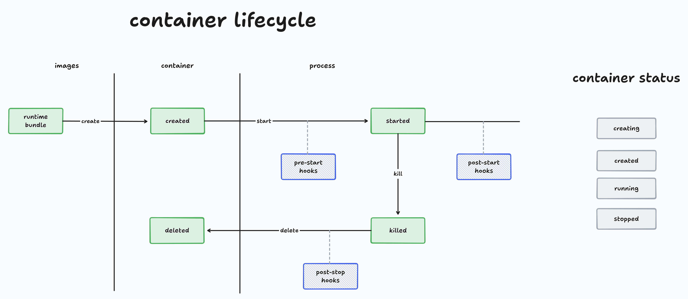

### OCI specs contract

### Detailed Architecture

### 3rd party dependencies

- [nix](https://crates.io/crates/nix) - for syscalls
- [serde](https://crates.io/crates/serde) - with `derive` feature for serializing and deserializing structs to/from json
- [serde_json](https://crates.io/crates/serde_json) - for serializing and deserializing structs to/from json
- [oci-spec](https://crates.io/crates/oci-spec) - for working with OCI specifications
- [anyhow](https://crates.io/crates/anyhow) - for error handling
- [clap](https://crates.io/crates/clap) - for parsing command line arguments

### codebase structure
we inspired from [youki](https://github.com/youki-dev/youki) codebase structure.

- libcontainer for runtime implementation
- libcli for cli operations

### process hierarchy
- **main process:**
  - provided command interface
  - parses config.json
  - set up cgroup directory
  - set up /run directory
  - creates IPS pipes
  - spawns the child (intermediate process
- **intermediate process:**
  - set up the rootfs
  - mounts /proc and /dev
  - set hostnames and other namespaces
  - once start this proccess disappear via execve 
- **child process:**
  - runs the containerized application 

