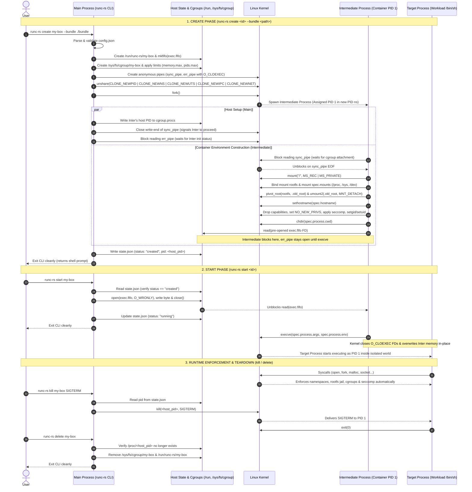

### OCI specs contract


## System boundaries

The runtime is organized as a strict dependency direction:

```text
runc-rs
  -> libcli
       -> libcontainer
            -> Linux APIs
```

- `runc-rs` wires the executable entry point and process-wide configuration.
- `libcli` owns argument parsing, command dispatch, and user-facing errors.
- `libcontainer` owns OCI lifecycle operations, runtime state, and container
  setup orchestration.
- Linux primitives are private modules inside `libcontainer` for the MVP.

This boundary keeps command handling independent of namespace, cgroup, mount,
and process APIs. A CLI command may call only the lifecycle API from
`libcontainer`; it must not call `nix` or manipulate `/run/runc-rs` directly.

## Container lifecycle API

The lifecycle API should expose operations rather than implementation details:

```text
create(bundle, id) -> RuntimeState
start(id) -> RuntimeState
kill(id, signal) -> RuntimeState
delete(id) -> ()
```

The MVP should keep these operations synchronous. Runtime state is persisted
under `/run/runc-rs/<id>/` and is the source of truth for command state
transitions.

### Detailed Architecture (sequence diagram)

### 3rd party dependencies

- [nix](https://crates.io/crates/nix) - for syscalls
- [serde](https://crates.io/crates/serde) - with `derive` feature for serializing and deserializing structs to/from json
- [serde_json](https://crates.io/crates/serde_json) - for serializing and deserializing structs to/from json
- [oci-spec](https://crates.io/crates/oci-spec) - for working with OCI specifications
- [anyhow](https://crates.io/crates/anyhow) - for error handling
- [clap](https://crates.io/crates/clap) - for parsing command line arguments

### codebase structure
we inspired from [youki](https://github.com/youki-dev/youki) codebase structure.

- libcontainer for runtime implementation
- libcli for cli operations


### process hierarchy
- **main process:**
  - provided command interface
  - parses config.json
  - set up cgroup directory
  - set up /run directory
  - creates IPS pipes
  - spawns the child (intermediate process
- **intermediate process:**
  - set up the rootfs
  - mounts /proc and /dev
  - set hostnames and other namespaces
  - once start this proccess disappear via execve 
- **child process:**
  - runs the containerized application 


